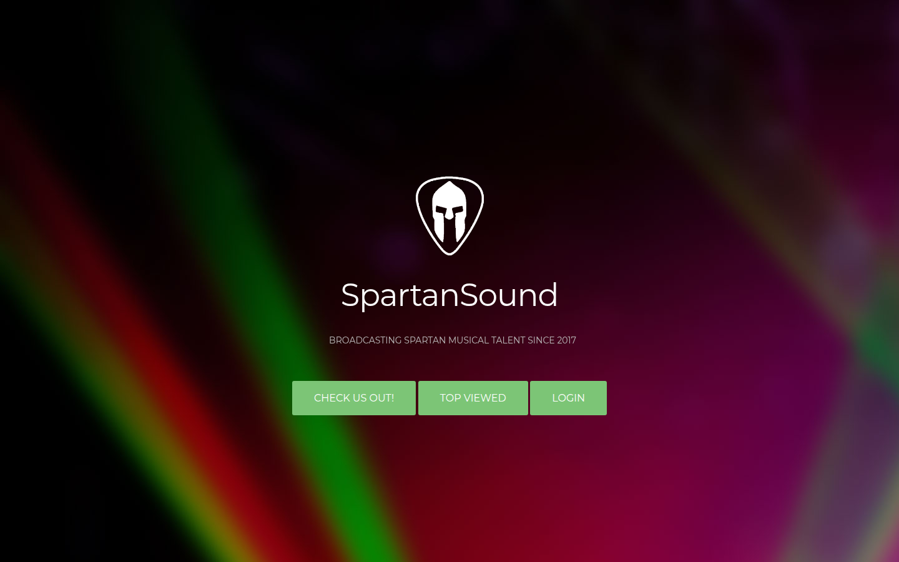
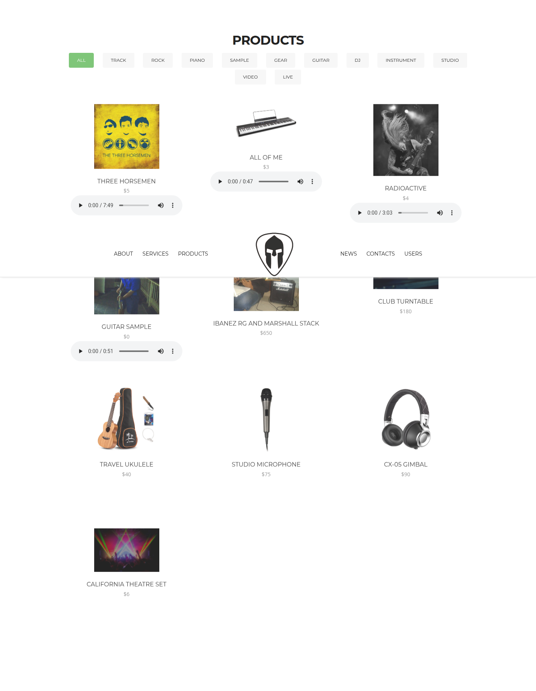
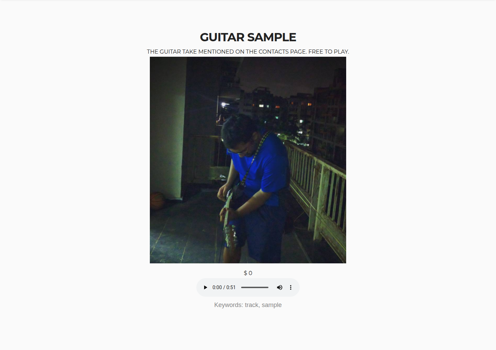
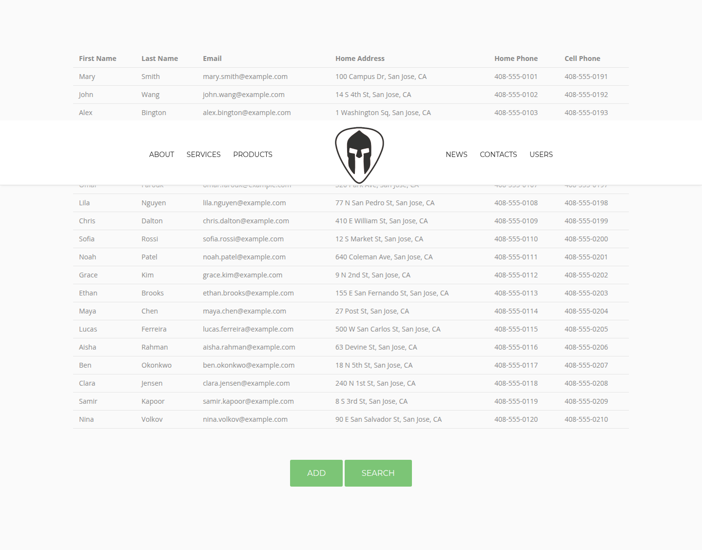

# SpartanSound

SpartanSound is a one-page shop for a fictional San Jose State music scene: students upload tracks, give some of them away, and sell used gear to each other. Pranav Prem built it in Spring 2017 for CMPE 272 with Prof. Richard Sinn. The class site lived at [pranavprem.com/spartansound](http://www.pranavprem.com/spartansound). This repo is that project.

The look is the [Knight](https://bootstrapmade.com/knight-free-bootstrap-theme/) theme by BootstrapMade. The footer credit is part of that theme and should stay.

## Original context

The site grew lab by lab, and the labs are still the shape of the code:

| Lab | What it added |
| --- | --- |
| 0 | A public PHP and MySQL host on a domain you controlled |
| 1 | Home, About, Products/Services, News, and Contacts. Contacts are read from a text file |
| 2 | An admin page that lists users after a userid/password login. The sample id was `admin` |
| 3 | A MySQL `users` table (name, email, address, phones), an add form, a search form, and at least 20 users |
| 4 | Ten products with their own pages, a cookie of the last five products you opened, and an extra-credit list of the five you personally viewed most often |

`includes/curls.php` is a later exercise that collected first names from classmates' sites. The wording of the assignment, as it was pasted into the old readme, is kept in [docs/original-readme.txt](docs/original-readme.txt).

The original MySQL database was never in git. [`sql/schema.sql`](sql/schema.sql) is a reconstructed catalog: ten products that use the images and audio already in the repo, and twenty fictional users so the Users section has something to search. Re-running that file drops both tables.

## How it works

`index.php` prints one long page. Each band (home, top viewed, about, services, products, news, contacts, users) is an include. There is no framework.

- **Contacts** are the lines of `txt/contacts.txt`.
- **Login** compares the form with `txt/credentials.txt`, one `username,password` pair per line. A match starts a PHP session and opens `secure.php`, which lists those usernames. This is separate from the database. The sample account is `admin` / `admin`. Any other line in that file also works. The passwords are plain text because that is how the lab was assigned.
- **Users** on the Users band are MySQL rows. Add and search write and read that table. Search ORs together whichever of name, email, and phone you filled in.
- **Products** come from MySQL. Opening `viewproduct.php?id=N` adds one to that row's `hits` column and prepends the id to a `lastids` cookie (30 days, capped at 100 entries so the extra-credit tally still has a history). The top of the home page lists the global top five by `hits`, the five ids you have opened most often, and the five most recent cookie entries.
- **Peer list** (`includes/curls.php`) prints first names from this database, then tries the 2017 classmate URLs. Those hosts are usually down. The page gives them a few seconds and skips whatever does not answer.

## Run it today

You need PHP 8.3 or newer (8.5 in Docker and CI) with `mysqli` and `curl`, plus MariaDB or MySQL. Database settings come from the environment.

### Docker

```bash
docker compose up --build
```

Open http://localhost:8080

The database password defaults to the local throwaway value `devpassword`. To use a different one, copy `.env.example` to `.env`, change `DB_PASSWORD`, and start Compose again with a fresh volume (`docker compose down -v`). The password is stored in the volume the first time the database boots.

Log in with `admin` / `admin`.

### PHP on the host

```bash
cp .env.example .env
# Create the database and user so they match .env, then:
php tests/load-schema.php
php -S localhost:8080 router.php
```

Start the server with `router.php`. That script is what stops the built-in server from handing out `txt/credentials.txt`. Apache uses `.htaccess` for the same paths.

Example database setup:

```bash
sudo mariadb -e "CREATE DATABASE spartansound;
  CREATE USER 'spartanuser'@'localhost' IDENTIFIED BY 'devpassword';
  GRANT ALL ON spartansound.* TO 'spartanuser'@'localhost';"
```

Use `127.0.0.1` as `DB_HOST` when the user is created for TCP, or `localhost` when you want the MariaDB socket. The example `.env` uses `127.0.0.1`.

## Tests

```bash
composer install
composer lint
composer test
php tests/load-schema.php
composer test:integration
```

Lint covers the maintained PHP (`includes/lib.php`, `includes/db.php`, the router, and `tests`). `php -l` covers the 2017 templates. GitHub Actions runs both, then the integration test against MariaDB 11.4.

## Tech stack

- PHP 8.3+ with mysqli (CI and Docker use 8.5). Pages are HTML includes, not a framework.
- MariaDB 11.4 in Docker. MySQL works too.
- jQuery 1.8.3, the Knight theme, Font Awesome 4.1, Isotope, and WOW.js, vendored from 2017.
- PHP_CodeSniffer (PSR-12) on the maintained PHP.
- GitHub Actions.

## Project structure

```
index.php                  the long home page
viewproduct.php            one product
secure.php                 admin user list
includes/                  page sections, login, user forms, database helpers
txt/contacts.txt           public contact lines
txt/credentials.txt        demo logins
sql/schema.sql             tables and reconstructed seed
router.php                 blocks private paths on the built-in server
tests/                     unit tests and an HTTP integration test
css/ js/ img/ audio/ fonts/  original theme and media
docs/original-readme.txt   the 2017 readme, assignment text included
```

## Screenshots

Captured from a local run of the reconstructed catalog.








